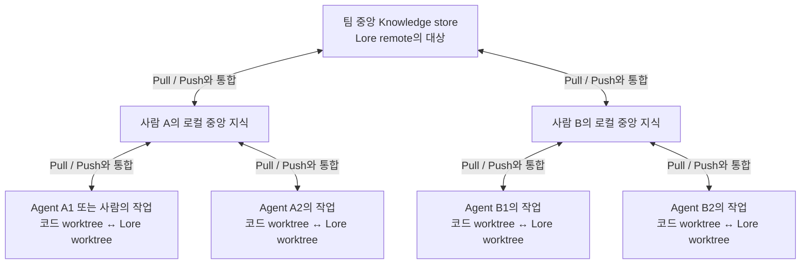
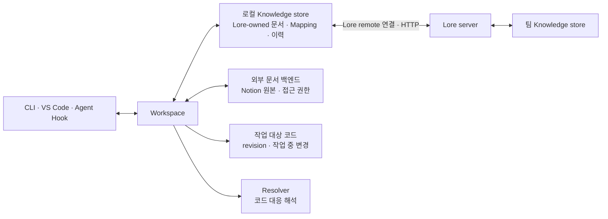

# Lore 설계와 기능

Lore는 외부 문서를 읽고, 문서와 코드의 관계를 기록하고, 그 지식을 worktree와 팀 사이에서 공유하는 도구입니다. CLI, VS Code 확장, Agent Hook이 같은 지식과 작업 규칙을 사용합니다.

이 문서는 실제 기능과 사용 흐름을 먼저 소개하고, 각 기능을 뒷받침하는 구조와 설계 의도를 설명합니다. 코드를 읽지 않고도 Lore의 주요 동작, 구성 요소, 현재 범위와 지원 계획을 이해할 수 있도록 정리했습니다.

| 기능 | 사용 경험 | 현재 범위 |
| --- | --- | --- |
| 문서 탐색 | Notion과 Local Documents를 트리에서 찾고 코드 옆에서 읽습니다. | VS Code 내장 reader, 제목 필터와 정규식, 문서 링크 탐색 |
| 코드 연결 | 문서를 코드 줄 범위 또는 파일 glob에 연결합니다. | Mapping 작성·조회·이력, 선택한 문서의 연결 목록, CodeLens |
| 코드 대응 | 이전 revision의 연결을 현재 코드 위치에 대조합니다. | 정확한 텍스트·Git rename 대응, 선택적 모델 후보 생성 |
| Agent 문맥 | 코드 경로가 등장하면 관련 문서 목록을 소개합니다. | 실행형 Hook, 세션 중복 방지, 교체 가능한 읽기·기록 skill |
| 로컬 문서 | Markdown을 작성하고 링크·디렉터리·이력·Archive를 관리합니다. | CLI와 확장 편집, 작업 사본과 중앙 지식 구분 |
| 지식 공유 | worktree별로 커밋하고 로컬 중앙이나 팀에 변경을 제출합니다. | 독립된 Lore worktree, 제안·통합, Fetch/Pull/Push, HTTP 서버 |
| 다양한 본문 형식 | Jupyter notebook처럼 코드·설명·실험 결과를 함께 담습니다. | **지원 예정:** `.ipynb`를 포함한 추가 형식의 읽기·편집 |

아래 CLI의 `<...>`는 사용자가 채울 ID나 값입니다. Notion 예시는 연결과 접근 권한이 준비된 환경을 가정하며, 명령은 작업 대상 코드 checkout에서 실행합니다.

## 문서 탐색과 읽기

현재 VS Code 확장은 Lore 영역 안에서 문서를 읽고, 선택한 문서의 코드 연결을 별도로 보여줍니다. Notion 문서와 Local Documents는 비슷한 탐색 경험을 제공하되, 외부 문서 편집은 원래 백엔드에 맡깁니다. 목록은 트리로 탐색하고 제목을 필터링할 수 있으며, 로컬 Markdown 문서는 렌더링과 편집을 전환합니다.

Notion 본문은 Markdown preview로 읽습니다. Notion 고유 블록과 원본 편집이 필요하면 Open in Notion으로 이동합니다. 문서 상단에는 제공 가능한 마지막 수정 시각, 생성자, 마지막 수정자를 표시합니다.

화면은 통합된 로컬 중앙 지식을 기준으로 탐색합니다. 작업 중인 저장 내용은 working copy로 구분하고, 게시할 때 중앙에 제출합니다. 누군가 다른 worktree에서 초안을 저장했다는 이유만으로 중앙 목록이 즉시 바뀌지는 않습니다.

읽을 때는 캐시를 우선 사용합니다. 목록을 갱신하는 일, 문서 한 개의 최신 본문을 가져오는 일, Lore의 공유 변경을 통합하는 일은 다릅니다. 문서를 열 때마다 Notion 전체를 탐색하거나, 목록을 새로고침할 때 모든 본문을 다시 받는 경험은 피하려고 합니다. 외부 문서의 캐시는 worktree 사이에서 공유할 수 있지만, 편집 초안과 코드 projection은 공유 작업 상태가 아닙니다.


*실제 VS Code 확장 화면입니다. 설명용 코드와 모의 Notion API를 사용해 촬영했습니다. Knowledge 안의 연속 제목 필터, 선택한 문서의 두 코드 연결, 아래쪽의 렌더링된 문서를 보여줍니다.*

CLI에서도 같은 문서를 탐색하고 읽을 수 있습니다.

```bash
lore init
lore docs browse notion
lore docs fetch notion
lore docs search notion scheduler
lore docs show notion <page-id>
lore docs fetch notion <page-id>
```

`docs fetch notion`은 설정된 범위의 제목 목록을 갱신하고, 문서 ID를 지정하면 그 문서를 갱신합니다. 전체 본문 캐시는 명시적인 선택입니다. VS Code의 Knowledge 새로고침도 목록 갱신이고, Document의 새로고침은 열린 문서의 갱신입니다. 제목 필터는 이미 알려진 목록에서 동작하며, 입력할 때마다 Notion을 검색하지 않습니다.

Notion 페이지는 연결하면 읽을 수 있고, 하위 문서의 목록 발견은 페이지별로 켭니다.

```bash
lore docs discovery notion <page-id> --enable
lore docs fetch notion
```

이 설정은 바로 아래 문서에만 적용되며 자식 페이지에 상속되지 않습니다. 읽기 권한과 목록의 발견 범위는 별개입니다. 링크를 따라 읽다가 순환하거나 깊은 계층을 만나는 일이 전체 트리의 재귀 수집으로 이어지지 않게 합니다.

이 경험의 목적은 코드에서 문서로 이동한 뒤 관련 문서와 코드로 읽기를 이어가는 것입니다. 나무위키처럼 문서 사이를 타고 배경을 알아가는 경험을 지향합니다. 문서가 코드 한 줄에 연결되어야만 읽을 가치가 생기는 것은 아닙니다.

## 코드 연결과 Projection

Mapping에는 “이 문서는 이 코드의 배경이다”라는 관계를 남깁니다. 외부 문서 매핑은 백엔드와 문서 ID를 참조하며, 하나의 코드 저장소 안에서 여러 Anchor나 파일 범위를 가질 수 있습니다. Lore-owned 문서에는 Anchor를 직접 붙일 수도 있습니다.

```bash
lore --json --author agent map create notion <page-id> \
  compiler/scheduler.py:100-150 --context "자원 배분 정책의 설계 배경"
lore map ls compiler/scheduler.py
lore map show <mapping-id>
lore --json map resolve <mapping-id>
```

정확한 줄을 고르기 어려운 넓은 설명은 경로 범위로 연결할 수 있습니다.

```bash
lore map create notion <page-id> --glob 'src/scheduler/**'
```

VS Code에서는 문서를 선택한 상태에서 코드 범위를 선택해 연결하고, Mappings에서 선택한 문서의 연결 수와 위치를 확인합니다. 코드의 CodeLens로 관련 문서를 열거나, 연결 목록에서 대응하는 코드로 이동할 수 있습니다.

Anchor는 파일 경로와 한 줄 또는 여러 줄의 범위뿐 아니라 **참조 당시 코드 revision과 문맥**을 보존합니다. 커밋되지 않은 코드에 연결했다면 그 사실도 구분해야 합니다. `scheduler.py:100-150`이라는 좌표만으로는 몇 달 뒤 같은 코드를 가리킨다고 판단할 수 없기 때문입니다.

때로는 정확한 줄보다 `src/scheduler/**` 같은 glob 범위가 적절합니다. 스케줄러 전체의 설계 배경을 특정 함수에만 붙이는 것은 오히려 관계를 좁게 표현합니다. glob은 넓은 관련성을, Anchor는 구체적인 코드 참조를 표현합니다. glob이 특정 줄의 의미까지 보증하는 것은 아닙니다.

Projection은 원본 Anchor를 현재 코드에 대조합니다. 예를 들어 중앙의 `scheduler.py`가 로컬 feature 브랜치에서 `planner.py`로 이동했다면, 원본 참조는 그대로 두고 로컬의 대응 위치를 별도로 제시합니다. 함수가 분리되면 여러 위치가 함께 대응할 수 있고, 여러 후보 중 하나를 확정하지 못할 수도 있습니다. 대응 위치를 찾지 못하는 것도 정상적인 결과입니다.

이 분리는 중요한 두 가지 오해를 막습니다.

1. **현재 위치를 찾았다고 원래 참조가 바뀐 것은 아닙니다.** 다른 worktree는 다른 코드 상태에 대한 projection을 가질 수 있습니다.
2. **현재 위치를 찾았다고 문서 내용이 맞는 것은 아닙니다.** 설계가 폐기되었거나 설명의 적용 조건이 달라졌는지는 별도의 판단입니다.

대응은 필요할 때 계산하고 적용 가능한 결과를 재사용할 수 있습니다. 모든 코드 변경마다 모든 Anchor를 모델에 보내는 구조를 요구하지 않습니다. 현재 구현은 정확한 텍스트와 Git rename 정보를 먼저 활용하며, 설정된 모델로 미확정 후보를 제안받을 수도 있습니다. Furiosa Access의 K-EXAONE을 기본으로 시작했지만, 모델 연결과 resolver profile을 분리해 모델·endpoint·프롬프트를 바꿀 수 있게 했습니다.

모델이 필요한 경우에만 명시적으로 요청합니다. 일반 문서 탐색과 코드 이동은 모델을 호출하지 않습니다.

```bash
lore --json map resolve <mapping-id> --resolver model --path compiler/
```

서버 측 reconciliation은 같은 문제를 공유 기준 코드에 대해 다루는 역할입니다. 제출된 참조를 설정된 canonical ref, 예를 들어 `upstream/master`에 대응시킬 수 있습니다. 그 ref는 모든 사용자의 로컬 코드 상태를 강제하는 기준이 아닙니다. 대응하지 못하면 원본과 불확실성을 보존하고, 문서 본문을 재작성하지 않습니다. 이 역할은 현재 후속 구현 범위입니다.

## Agent 문맥과 자동 소개

Agent는 자동 소개를 받거나 CLI로 필요한 경로의 관계를 직접 조회할 수 있습니다. Discovery는 문서 본문 전체를 읽는 작업과 구분됩니다.

```bash
lore --json --central context discover compiler/scheduler.py
lore docs show notion <page-id>
```

Agent도 사람과 같은 관계를 사용하지만, 발견을 위한 인터페이스는 다릅니다. 관련 문서를 매번 전부 읽고 어느 것이 맞는지 추측하게 하기보다, 다루는 코드 경로를 기준으로 후보 목록을 전달합니다.

예를 들어 `src/scheduler/**`에 연결된 Lore가 있다면, Agent의 문맥에 해당 경로가 등장했을 때 Hook이 문서 참조와 관련 코드 범위를 소개할 수 있습니다. 특정 명령의 `cat`, `sed`, `rg` 문법을 각각 해석해서 모든 파일 접근을 추적하는 방식에 의존하지 않습니다. 현재 adapter는 도구 입출력의 경로 언급을 이용하므로 best-effort discovery이며, 실제 파일 접근을 완벽하게 감지하는 기능은 아닙니다.

자동 소개는 본문 전체를 무조건 주입하지 않습니다. **관련 Lore가 있다는 사실, 문서 참조, 기록된 코드 범위**를 먼저 전달하고, Agent가 필요한 문서를 선택해 읽게 합니다. 라인은 참조 당시 위치일 수 있으므로 현재 코드와의 대응이 필요하면 Projection을 조회합니다. 같은 Agent 세션에서는 문서를 자동으로 최대 한 번 소개하고, 명시적 discovery와 읽기는 언제든 허용합니다.

Hook, skill, resolver는 서로 다른 책임을 가집니다. Hook은 발견 계기와 중복 방지를 담당하고, skill은 Lore를 읽고 활용하거나 새 결론을 기록하는 작업 방식을 안내하며, resolver는 코드 대응을 해석합니다. 특정 언어의 skill이나 특정 모델의 프롬프트를 제품의 핵심 계약으로 고정하지 않습니다.

현재 실행형 adapter는 SessionStart에서 workspace를 준비하고, PostToolUse에서 관련 문서 참조를 소개합니다. 선택적으로 사용하는 Stop Hook은 재사용할 새 결론이 생겼는지 점검하도록 요청합니다. 읽기 skill과 기록 skill은 분리되어 있고, 기록 정책에 따라 작업 브랜치에서 문서를 작성·커밋한 뒤 로컬 중앙에 제출합니다. Hook 자체가 대화를 문서로 변환하거나 모델을 호출하는 것은 아닙니다. 팀 remote로의 제출은 별도의 동작입니다.

이렇게 분리하면 Agent가 기존 Notion 도구로 문서를 읽는 경우에도 코드 관계는 Lore에 남길 수 있습니다. 새 실험 결론을 Lore-owned 문서로 남기거나, 기존 문서에 매핑만 추가하는 것도 가능합니다. 현재 Agent 연결의 중심은 구조화된 CLI 결과와 실행형 Hook·skill이고, MCP 같은 인터페이스도 같은 작업 의미를 따르는 방향입니다.

## 로컬 문서 작성과 관리

외부 백엔드에 작성할 필요가 없는 실험 결과나 배경 설명은 Local Documents로 남길 수 있습니다. Markdown 본문을 파일이나 표준 입력으로 작성하고, 코드 연결 없이도 저장·조회할 수 있습니다.

```bash
lore --json create "Scheduler Design" --body-file design.md --directory design
lore attach <document-id> compiler/scheduler.py:100-150
lore edit <document-id> --if-match <revision> --body-file design.md
lore history <document-id>
```

편집·Archive 같은 변경은 관찰한 revision을 확인합니다. 다른 작업자가 먼저 변경했다면 내용을 조용히 덮어쓰지 않습니다. 생성·수정 결과의 revision을 다음 작업에 사용합니다.


*설명용 로컬 문서의 실제 확장 화면입니다. 문서는 아래 reader에 렌더링되고, Edit로 본문을 수정합니다. Saving은 작업 사본을 기록하고 Publishing은 커밋과 로컬 중앙 제출을 수행합니다.*

문서는 제목과 본문을 가진 지식이며, 코드 연결 없이도 존재할 수 있습니다. 문서 참조는 백엔드의 정체성과 그 안의 문서 ID로 구성됩니다. 제목은 읽기 위한 이름이므로 중복될 수 있고, 제목이나 위치를 바꿔도 같은 문서의 연결은 유지됩니다. 다른 백엔드로 복사한 문서는 별도의 문서이며 자동으로 같은 원본으로 간주하지 않습니다.

Lore가 소유하는 문서는 Markdown을 기본 형식으로 사용합니다. 형식을 Markdown으로만 고정하지 않아 향후 **Jupyter notebook (`.ipynb`)** 같은 내용을 지원할 계획이지만, 모든 형식의 읽기·편집을 현재 지원하는 것은 아닙니다. 외부 문서는 원래 백엔드가 제공하는 본문 형식과 편집 기능을 따릅니다.

문서의 분류는 트리 구조를 사용합니다. Local Documents에는 중첩된 디렉터리가 있고, Notion 문서는 Notion의 계층을 따릅니다. 문서 디렉터리는 코드 경로나 문서의 정체성과는 별개입니다. 코드를 설명하는 위치와 사람이 문서를 정리하는 위치가 같아야 하는 것은 아닙니다.

문서끼리의 링크도 백엔드와 본문 형식의 관례를 따릅니다. 로컬 Markdown에서는 안정적인 문서 ID를 참조하는 위키 링크를 사용하고, Notion에서는 원래 페이지 링크를 활용합니다. Lore는 제공 가능한 링크를 탐색에 연결하되, 제목이 모호하면 임의의 문서로 연결하지 않습니다. 링크 대상이 아직 없거나 접근할 수 없어도 현재 문서를 읽는 일은 계속할 수 있습니다.

작성자, 변경 이력, 마지막 수정자와 수정 시각은 알 수 있는 범위에서 유지합니다. 문서 작성자와 Mapping 작성자는 별개의 정보입니다. Lore-owned 문서와 Mapping은 이력을 보존하지만, 외부 문서를 캐시했다고 Notion의 모든 과거 버전을 조회할 수 있게 되는 것은 아닙니다.

Archive도 삭제와 다릅니다. Lore-owned 문서를 archive하면 정체성, 내용, 참조를 보존하고 다시 복원할 수 있습니다. Mapping만 archive할 수도 있으며, 이때 연결된 원본 문서를 archive하지 않습니다. 현재 탐색 화면은 archived 항목을 기본적으로 숨기고 필요할 때 포함합니다. 백엔드에 접근하지 못했다는 사실을 문서 삭제로 해석하지 않습니다.

CLI의 `archive`와 `restore`도 관찰한 revision을 `--if-match`로 확인합니다. 문서 사이의 연결은 `links`로 조회할 수 있습니다.

위키 링크는 예를 들어 `[[id:<document-id>|Resource Ownership]]`처럼 표현합니다. 보이는 제목과 실제 문서 ID를 분리하므로 제목이나 디렉터리를 바꿔도 연결을 유지할 수 있습니다.

## worktree 작업과 지식 공유

각 코드 worktree는 독립된 Lore 작업 브랜치와 작업 사본을 가집니다. 작성과 커밋은 해당 작업 환경에 남고, 로컬 중앙에 제출·통합한 지식은 중앙 화면과 다른 작업자에게 발견됩니다. 다른 브랜치의 내용은 Pull로 반영합니다.

Lore는 다음 계층을 같은 제출·통합 규칙으로 연결합니다.



Agent는 자기 코드 worktree에 대응하는 Lore worktree에서 독립적으로 작업합니다. 커밋은 그 작업 브랜치의 이력을 만들고, Push는 로컬 중앙에 변경을 제안합니다. 중앙에 통합되면 사람의 VS Code 화면에서 발견할 수 있고, 다른 작업 브랜치는 Pull로 반영합니다.

사람의 로컬 중앙은 Agent들에게는 공유 대상이지만, 팀 중앙에 대해서는 변경을 제출하는 쪽입니다. 로컬 중앙에 받아들인 지식 중 팀에 공유할 것을 선택해 Lore remote에 제출합니다. 팀에서 받아들인 변경도 먼저 각 사람의 로컬 중앙으로 가져온 뒤, 필요한 작업 브랜치가 반영합니다.

그림은 하나의 공유 대상을 보여주지만, 사람마다 여러 Lore remote를 사용할 수 있습니다. 팀 store와 개인 store, 실험용 store가 함께 존재할 수 있습니다. 하나의 remote를 연결했다는 이유로 모든 로컬 문서를 그곳에 보내지는 않습니다.

### 저장, 커밋, 제출, 통합

작업 내용을 저장하고, 이력으로 기록하고, 공유 대상으로 제출하고, 중앙에 받아들이는 일은 서로 다른 단계입니다. Lore는 이 차이를 드러냅니다.

| 작업 | 의미 |
| --- | --- |
| 작성·편집 | workspace의 로컬 변경을 기록합니다. 다른 브랜치나 중앙에 자동 게시하지 않습니다. |
| Commit | 선택한 문서 또는 매핑을 Lore 작업 브랜치의 이력에 기록합니다. |
| Push | 커밋된 변경을 부모 중앙에 제안합니다. 제출과 통합은 구분됩니다. |
| Integration | 제안을 확인한 중앙 상태에 대해 통합합니다. 같은 문서나 매핑의 동시 변경은 충돌로 남깁니다. |
| Fetch | 공유 지식을 가져와 관찰·캐시하지만, 작업 브랜치나 통합 기준을 바꾸지 않습니다. |
| Pull | 받아들여진 공유 변경을 자신의 상태에 통합합니다. 로컬 편집을 조용히 덮어쓰지 않습니다. |
| Checkout / Worktree | 지식 작업 브랜치를 선택하거나, 코드 checkout에 대응하는 독립된 작업 환경을 제공합니다. |

작업 상태는 `lore worktree`로 확인하고, `lore checkout investigation --create`로 별도의 지식 작업 브랜치를 만들 수 있습니다. 코드 checkout 자체를 바꾸는 명령은 아닙니다. 미커밋 변경이 있다면 브랜치 전환을 거부해 보존합니다.

로컬 Push는 충돌이 없으면 즉시 통합할 수 있고, 제안만 남길 수도 있습니다. 팀 remote로 Push하면 제출된 제안을 별도로 통합합니다. 중앙에 통합되었다는 것은 공유 상태에 포함되었다는 뜻이며, 반드시 사람이 검토했거나 설명의 정확성을 보증한다는 뜻은 아닙니다.

앞서 작성한 Mapping을 커밋해 로컬 중앙에 제출하는 대표적인 흐름은 다음과 같습니다. `<mapping-id>`와 `<revision>`은 작성·조회 결과에서 얻습니다.

```bash
lore commit <mapping-id> --mapping --if-match <revision>
lore push
lore --central map ls compiler/scheduler.py
```

Lore-owned 지식은 `create`, `attach`, `show`로 다루고 같은 commit·제출 흐름을 사용합니다. 파일 범위의 관계는 `map create ... --glob 'src/scheduler/**'`로 기록할 수 있습니다. 사람과 Agent가 다른 도구를 사용하더라도 같은 workspace 상태와 충돌 규칙을 따릅니다. `--json`과 `--if-match`는 결과를 구조적으로 읽고, 관찰한 버전이 바뀌었을 때 무심코 덮어쓰지 않게 하는 인터페이스입니다.

제안만 남기고 먼저 확인하는 흐름도 가능합니다.

```bash
lore push --proposal
lore proposal show <proposal-id>
lore proposal integrate <proposal-id> --if-match <central-version>
```

공유 범위는 명시적으로 선택합니다. `push --remote team --mapping-id <id>`는 선택한 로컬 중앙 매핑을 팀에 제안하고, `--document <id>`는 Lore-owned 문서를 제안합니다. `pull --remote team`은 팀 변경을 로컬 중앙에 반영하며, 작업 브랜치에서는 별도의 `pull`로 가져옵니다. `fetch --remote team`은 중앙에 통합하지 않고 먼저 관찰할 때 사용합니다.

팀 공유를 시작할 때는 서버의 store와 인증 정보를 받아 Lore remote를 연결합니다. 처음에는 Pull로 팀의 기준 상태를 가져온 뒤 선택한 지식을 제출합니다.

```bash
lore remote add team --url <server-url> --store <store-id>
lore remote auth set team --stdin
lore pull --remote team
lore push --remote team --mapping-id <mapping-id>
```

원격 제안도 `lore proposal --remote team show ...`와 `integrate ...`로 확인·통합합니다. `lore fetch --remote team`은 관찰만 하고, `lore pull --remote team`은 받아들여진 지식을 로컬 중앙에 반영합니다. 작업 브랜치에서는 다시 `lore pull`을 사용합니다.

Notion에 대한 `docs fetch`는 이 지식 공유와 별개입니다. 백엔드의 목록이나 선택한 본문을 갱신하는 작업입니다. Notion 문서를 읽기 위해 Lore remote에 Push할 필요도 없고, 매핑을 Push한다고 Notion 본문이 편집되는 것도 아닙니다.

충돌한 제안과 로컬 내용, 기준 버전은 보존합니다. Agent가 해결안을 만들 수 있지만 적용은 명시적이어야 하고, 그동안 상태가 바뀌었다면 다시 확인해야 합니다. 네트워크 응답이 불확실해 재시도하더라도 게시가 중복되거나 로컬 변경이 사라지지 않는 것이 공유 계약의 일부입니다.

예를 들어 두 Agent가 같은 기준에서 서로 다른 문서를 추가했다면 중앙은 두 변경을 함께 받아들일 수 있습니다. 같은 문서나 Mapping을 각각 수정했다면, 나중 제안을 먼저 내용을 덮어쓰는 방식으로 받아들이지 않습니다. 현재 병합의 단위는 문서 또는 Mapping이며, 한 문서 안의 서로 다른 문장을 고쳤다고 자동으로 합치지는 않습니다.

해결할 때는 기준 상태, 현재 중앙 상태, 제안 상태를 비교해 새 내용을 준비하고, 관찰한 상태가 여전히 같은지 확인한 뒤 적용합니다. Push에 성공했다는 것은 제안이 서버에 남았다는 뜻일 수 있습니다. 제안의 통합과 이후 Pull까지 구분해야 다른 작업자에게 무엇이 보이는지 알 수 있습니다.

## 구성 요소와 연결 이름

여기서 가장 혼동하기 쉬운 단어는 remote입니다. **Lore에서 remote는 지식을 공유하는 대상에 대한 연결**을 뜻합니다. 코드 저장소의 Git remote나 Notion 문서 백엔드 연결과는 별개입니다.

| 개념 | 의미 |
| --- | --- |
| Code repository / Git remote | 작업 대상 코드의 저장소와 Git 연결입니다. 코드의 정체성과 이력을 제공합니다. |
| Document backend | 문서의 원본과 접근을 담당합니다. Notion 같은 외부 서비스나 Lore가 소유하는 문서가 해당합니다. 백엔드의 종류와 연결된 문서 공간의 정체성은 구분됩니다. |
| Knowledge store | Lore-owned 문서, 매핑, 작업 이력, 통합된 중앙 지식, 변경 제안을 관리하는 지식 저장소입니다. |
| Lore remote | Lore server를 통해 특정 Knowledge store에 접근하는 이름 있는 연결입니다. `team` 같은 로컬 이름은 연결 대상의 고유 ID와 다릅니다. |
| Lore server | 인증과 권한을 확인하고 공유 지식의 조회, 제출, 통합을 제공합니다. 하나의 서버가 여러 독립된 store를 제공할 수 있습니다. |
| Workspace | 코드 checkout과 지식 작업 상태를 연결하는 로컬 작업 환경입니다. 어떤 store를 사용하고, 어떤 변경과 projection을 보유하는지 관리합니다. |
| Lore worktree / working branch | 한 workspace의 지식 작업 사본과 이력입니다. 코드 worktree와 대응하지만, 코드 저장소 안에 문서를 넣지는 않습니다. |
| Mapping / Anchor | 문서와 코드의 지속적인 관계, 그리고 그 관계가 가리키는 구체적인 코드 참조입니다. |
| Projection / Resolver | 기록된 코드 참조가 다른 코드 상태에서 어디에 대응하는지 해석한 결과와 그 해석을 수행하는 구성 요소입니다. |

Knowledge store 하나에 여러 코드 저장소와 여러 문서 백엔드를 등록할 수 있습니다. store 안에서는 코드 저장소별로 중앙 지식과 작업 이력을 관리합니다. 반대로 같은 코드 저장소에 대해 서로 다른 팀이 독립된 store를 운영할 수도 있습니다. 같은 Notion 문서 공간을 참조하더라도 서로 다른 코드 관계를 축적할 수 있습니다.

따라서 “이 코드 저장소를 열었다”만으로 어느 팀의 지식을 쓰는지가 정해지지는 않습니다. workspace가 로컬 store를 선택하고, 공유할 때는 Lore remote를 선택합니다. 저장소·백엔드 등록은 공유 공간의 구성이고, 개인의 토큰과 연결 이름은 그 공간을 사용하는 환경의 설정입니다. 접근 권한도 저장소와 백엔드의 조합을 유지합니다.

로컬에서 혼자 사용하거나 여러 worktree 사이에서 공유할 때는 서버를 띄울 필요가 없습니다. 코드 저장소 밖의 로컬 store가 중앙 역할을 합니다. 현재 기본 위치는 `~/.local/share/lore/`이며, 다른 store를 선택할 수도 있습니다. Lore remote를 같은 머신의 서버로 구성하는 것도 가능하지만 필수는 아닙니다.

연결 관계를 수로 표현하면 서버는 여러 store를 제공할 수 있고, store와 코드 저장소·문서 백엔드는 각각 N:M 관계입니다. 하나의 문서는 여러 코드 저장소에 연결될 수 있지만, 개별 Mapping은 한 문서와 한 코드 저장소를 연결합니다. 그 안에서 여러 Anchor나 경로 범위를 사용할 수 있습니다. 여러 로컬 remote 이름이 같은 store를 가리킬 수도 있습니다.

구성 요소 사이의 주요 흐름은 다음과 같습니다. 외부 본문을 읽는 경로와 Lore 지식을 공유하는 경로가 구분되어 있습니다.



Workspace는 관련 문서를 찾을 때 로컬 중앙 지식과 알려진 원격 관계를 조회하고, 본문을 읽을 때 문서 캐시나 원래 백엔드를 사용합니다. 서버는 팀의 공유 상태를 관리하며, 외부 문서에 대한 개인 인증을 대신 부여하는 역할은 아닙니다. 그림의 Resolver는 필요할 때 호출하며 모든 읽기나 동기화에 개입하지 않습니다.

## 공유 서버와 선택적 reconciliation

공유 서버가 필요하다면 CLI로 설정을 만들고 실행할 수 있습니다. 서버 하나는 여러 store를 제공할 수 있으며, 각 사용자의 repository/backend 조합에 대한 읽기·쓰기 권한을 확인합니다.

```bash
lore --json server config --repository "<repository-id>" \
  --backend local --backend "<backend-id>" > server.json
lore server serve --config server.json --data-dir "<data-directory>"
```

설정에 지정한 토큰 환경변수와 사용자별 권한을 준비해야 합니다. `local` backend 권한은 Lore-owned 문서를 다루는 권한이고, Notion Mapping 접근 권한이 Notion 본문 권한을 대신하지 않습니다.

Lore server는 공유 공간의 서비스입니다. 저장소를 선택하고, 요청자를 인증하고, 변경 제안을 받아 통합하는 역할은 모델의 지능에 의존하지 않습니다.

별도의 Agent나 worker는 코드 변화에 따라 공유 Anchor를 보정하거나, 오래된 관계를 조사하고 정리하는 역할을 맡을 수 있습니다. 하지만 이런 Agent가 없거나 일시적으로 동작하지 않는다고 Push/Pull까지 멈추게 만들지는 않습니다. 원래 참조를 보존한 채 공유하고, 대응이 해결되지 않은 상태를 구분할 수 있어야 합니다.

서버 자체가 내려가면 원격 제출은 할 수 없습니다. 그래도 이미 가진 문서와 관계를 읽고, 로컬 작업을 기록·커밋하고, 로컬 중앙에 제출하는 일은 계속할 수 있습니다. 모델이 필요한 새로운 Projection이나 아직 가져오지 않은 외부 문서까지 오프라인에서 제공한다고 약속하는 것은 아닙니다.

이 경계는 구조를 교체할 때도 중요합니다. 문서 백엔드, 지식 저장소, 서버, resolver 모델, Hook과 skill의 정책은 각각의 책임에 맞게 선택합니다. 서버에 쓰는 모델 토큰과 개인이 로컬에서 쓰는 토큰도 별도 설정이며, 지식 이력에 토큰이나 개인 인증을 담지 않습니다.

## 연결 설정과 실행 환경

설정도 역할에 따라 나뉩니다. **Local store connection**은 사용할 로컬 지식 저장소를, **Lore remote**는 서버 주소와 공유 store를, **Backend connection**은 문서 접근과 discovery 범위를 선택합니다. **Model connection**은 모델 API와 인증을 설정하고, **resolver profile**은 그 연결에서 사용할 모델·프롬프트·요청 제한을 선택합니다. Notion 토큰, Lore server 토큰, 모델 API 토큰은 서로 다른 권한입니다.

같은 모델 연결에 여러 profile을 만들 수 있습니다. 모델을 바꿀 때 지식 저장소나 Notion 연결까지 다시 만들 필요는 없습니다. 개인의 문서·모델 인증은 같은 Lore 데이터 홈을 사용하는 CLI, 확장, Hook에서 재사용하며, 다른 사람에게 공유할 지식과는 분리합니다. 서버 인증은 실제 요청자를 식별하고, 문서나 Mapping의 human·agent 작성 표기는 기여의 출처를 나타냅니다.

핵심 동작은 Rust의 공통 모델과 로컬 작업·저장소·백엔드·서버·resolver 모듈에 나누어 구현합니다. CLI는 이를 사용할 수 있는 기본 인터페이스이고, 현재 VS Code 확장과 실행형 Hook도 CLI를 사용합니다. 따라서 편집기에서만 해석되는 별도 지식 형식이나 Agent에게만 적용되는 동기화 규칙을 만들지 않습니다. 서버 저장소 인터페이스는 구현과 분리되어 있지만, 다른 저장 엔진이나 백엔드를 모두 설정만으로 사용할 수 있게 구현한 것은 아닙니다.

모델 설정의 대표적인 흐름은 다음과 같습니다. 토큰은 개인 실행 환경에 등록하고 profile에서 사용할 모델을 선택합니다.

```bash
lore resolver connection set furiosa
lore resolver auth set furiosa --stdin
lore resolver profile set rngd --connection furiosa \
  --model furiosa-ai/K-EXAONE-236B-A23B-NVFP4A16
lore resolver use rngd
```

다른 endpoint에는 다른 connection을 만들고, `--profile <name>`으로 작업별 profile을 선택할 수 있습니다. VS Code의 Configure Resolver와 Select Resolver도 같은 설정을 사용합니다. 모델 토큰을 지식 remote에 Push하지 않습니다.

Remote SSH로 코드 작업을 한다면 CLI와 Hook이 실행되는 원격 호스트의 Lore 설정과 캐시를 사용합니다. 팀 서버는 공유 지식을 제공하지만, 사람별 작업 환경은 그대로 독립적입니다. 실행 환경이 바뀌면 그 환경에 필요한 연결과 인증을 준비해야 합니다.

현재 설치는 소스에서 CLI를 설치하고 VSIX로 확장을 설치하는 개발 흐름입니다. 향후 CLI는 GitHub Releases, Agent 플러그인은 Git 기반 marketplace, VS Code 확장은 별도 설치 안내에서 사내 marketplace로 발전시키는 방향을 생각하고 있습니다. 배포 방식과 지식 공유 방식은 별개이며, 소스 저장소를 GitHub에서 배포한다고 지식을 GitHub에 저장해야 하는 것은 아닙니다.

## 기존 Notion 지식을 활용하는 이유

팀의 Notion에는 130여 개의 PR 디자인·아이디어 문서가 있습니다. 이미 작성과 논의를 거친 지식을 별도 이관 없이 활용하고, 앞으로 같은 공간에 추가되는 문서도 연결하는 것이 Lore의 중요한 장점입니다. 새 도구를 쓰기 위해 기존 문서를 모두 옮기거나 두 곳에서 관리하는 부담을 줄입니다.

그래서 Notion을 **문서 백엔드**로 사용합니다. 본문, 작성·편집, 이력, 접근 권한은 Notion에 남겨두고, Lore는 문서의 안정적인 ID와 코드 사이의 관계를 관리합니다. 문서를 Lore에서 읽기 위해 캐시할 수 있지만, 캐시가 새로운 원본이 되는 것은 아닙니다.

예를 들어 Agent가 스케줄러를 조사하면서 어느 Notion 설계 문서가 `compiler/scheduler.py`의 특정 로직을 설명한다는 사실을 발견했다고 합시다. 그 관계를 Lore에 남기면 다음 사람이나 Agent는 같은 탐색을 처음부터 반복할 필요가 없습니다. 새 설계 문서도 기존 Notion 공간에 작성한 뒤, 필요한 코드에 연결하는 방식으로 참여할 수 있습니다. 처음부터 모든 문서에 매핑이 있어야 하는 것은 아닙니다.

[Notion MCP](https://developers.notion.com/guides/mcp/overview)는 이미 Agent에게 Notion 검색·읽기·작성 도구를 제공합니다. Lore가 추가하려는 가치는 **코드에서 출발하는 발견과 지속적인 코드–문서 연결**입니다. Agent가 문서 제목을 떠올려 검색하기 전에, 지금 다루는 파일에 관련 문서가 있다는 사실을 알려줄 수 있습니다. Notion MCP로 본문을 읽거나 편집하면서 Lore로 매핑을 관리하는 사용 방식도 가능합니다.

## 문서, 코드, 연결을 분리하는 이유

외부 문서 백엔드를 활용하면서 Lore가 직접 소유하는 문서도 함께 다루는 구조를 선택했습니다. 문서 관리까지 모두 맡으면 기존 지식을 활용하기 위해 새 문서 시스템으로 이관하는 부담이 커지기 때문입니다.

이 선택은 단순히 저장 위치를 나누는 것 이상입니다. 다음 세 가지는 독립적으로 변할 수 있습니다.

- **코드:** 브랜치, 커밋, 리팩터링, 작업 중인 변경에 따라 위치와 구현이 달라집니다.
- **문서:** 설계 의도나 실험 결론을 담고, 코드 연결이 없어도 의미를 가질 수 있습니다.
- **매핑:** 어떤 문서가 어느 코드의 배경인지에 관한 관계입니다. 본문을 수정하지 않고 추가하거나 보정할 수 있습니다.

함수가 이동했다고 해서 설계 문서를 다시 써야 하는 것은 아닙니다. 반대로 설명이 바뀌었다고 해서 코드 위치가 바뀌는 것도 아닙니다. 문서를 작성한 사람과 연결을 발견한 Agent 역시 다를 수 있습니다. Lore는 이 차이를 보존하려고 합니다.

Notion 문서를 연결하는 작업은 Notion 본문을 복제해 게시하는 작업이 아닙니다. Lore-owned 문서를 공유할 때는 Lore가 그 본문과 이력을 관리하지만, 외부 문서를 공유할 때는 참조와 코드 관계를 공유합니다. 문서 제목이 같다고 같은 문서로 합치거나, 매핑을 볼 수 있다는 이유로 본문 접근 권한을 부여하지 않습니다.

## Git과 DVC에서 가져온 생각

Git과 닮은 점은 작업 이력과 공유의 경계를 나눈다는 것입니다. 독립된 작업 브랜치, 커밋, 기준 버전, 제출과 통합을 통해 여러 작업자의 변경을 관리합니다. 코드 worktree와 지식 worktree를 대응시키는 선택도 [Git worktree](https://git-scm.com/docs/git-worktree)의 독립된 작업 사본이라는 생각과 맞닿아 있습니다.

그러나 코드 커밋과 Lore 커밋은 같은 이력이 아니고, Git remote와 Lore remote도 같은 대상이 아닙니다. 특히 Lore의 remote Push는 제안을 만들기 때문에, Git의 브랜치 전송과 동작이 동일하지 않습니다. [Git의 remote 개념](https://git-scm.com/book/en/v2/Git-Basics-Working-with-Remotes)에서 익숙한 연결 이름과 여러 공유 대상을 사용하는 감각을 가져오되, Lore의 제출·통합 의미는 별도로 정의합니다.

현재 Git은 Lore의 이력과 worktree를 구현하는 수단입니다. Knowledge store 인터페이스와 공유 프로토콜은 별도로 두고, 저장소 버전 토큰을 외부 계약에서 Git 해시로 가정하지 않습니다. 지식을 GitHub에 게시하거나 Git 프로토콜로 전송해야 한다는 뜻도 아닙니다. 현재 Lore server는 HTTP API로 제안을 받습니다.

DVC와 닮은 점은 원본·캐시·작업 상태를 구분하고 필요한 범위를 의식한다는 것입니다. DVC의 [Fetch](https://doc.dvc.org/command-reference/fetch)는 데이터를 캐시에 가져오고, [Pull](https://doc.dvc.org/command-reference/pull)은 작업 사본에도 반영하며 대상을 제한할 수 있습니다. Lore에서도 “가져와서 알게 되었다”와 “내 작업 상태에 반영했다”를 구분하고, 코드 파일이나 디렉터리에서 필요한 지식을 찾고자 합니다.

다만 이것은 DVC와 동일한 다운로드·checkout 규약이라는 뜻은 아닙니다. 외부 문서의 원본과 편집 계약은 백엔드에 남고, Lore는 지식 변경과 코드 관계를 통합합니다. 파일별로 모든 원격 지식을 잘라 전송하는 기능까지 현재 구현했다고 가정해서도 안 됩니다. 현재 범위 선택은 코드 기반 discovery, 외부 본문의 지연 조회, 선택적 원격 제출을 중심으로 제공하며, Lore-owned 원격 지식의 Fetch는 본문을 포함할 수 있습니다.

## Swimm, Google Code Wiki와의 차이

코드 옆에서 설명을 발견하고 문서와 코드를 오가는 경험은 다른 도구들과 겹칩니다. Lore의 방향을 설명할 때는 기능의 유무보다 지식의 원본, 이력, 공유를 어디에 두는지에 주목할 필요가 있습니다.

| 접근 | 대표적인 출발점 | Lore가 두는 초점 |
| --- | --- | --- |
| Notion MCP | Notion 문서에 대한 검색·읽기·작성 도구 | 코드 경로와 줄 범위에서 관련 문서를 발견하고, 발견한 관계를 지속적으로 공유합니다. |
| Swimm의 코드 연계 Docs-as-code | 저장소의 Markdown 문서에 코드 snippet을 연결하고 함께 관리 | 원본 문서는 기존 백엔드에 유지하고, 코드와의 관계·작업 이력을 별도로 관리합니다. |
| Google Code Wiki | 코드를 분석해 구조화된 위키를 생성·갱신 | 이미 작성된 설계 의도, 논의, 실험 지식을 활용하고 코드에 연결합니다. 생성된 지식도 같은 구조로 참여할 수 있습니다. |

Swimm의 코드 연계 방식을 소스코드 줄 안에 문서를 주석으로 넣는 것으로 이해하면 정확하지 않습니다. 공식 FAQ의 코드 연계 문서는 저장소의 Markdown 파일로 관리되고, snippet과 IDE 연결을 제공합니다. FAQ에는 Cloud Docs도 소개되어 있으므로 모든 Swimm 문서가 반드시 코드 저장소 안에 있다고 단정할 수는 없습니다. 여기서 비교하는 것은 그 **코드 연계 Docs-as-code 방식**입니다. Lore는 기존 Notion 문서를 코드 저장소의 문서로 옮기거나 같은 Git 이력에 편입시키지 않고 활용하려는 선택을 합니다. [Swimm 공식 FAQ](https://docs.swimm.io/faq/)

Google은 Code Wiki를 코드베이스를 분석해 변경에 맞춰 문서를 재생성하고, 코드 링크와 Gemini 기반 질의응답을 제공하는 시스템으로 소개합니다. Lore 역시 코드 이해를 돕지만, 선택의 이유나 실패한 실험처럼 코드에서 다시 생성하기 어려운 지식을 출발점으로 삼습니다. 따라서 생성 위키를 대체해야만 하는 관계는 아니며, 기존 지식에 대한 연결 계층과 함께 활용하는 방향도 생각할 수 있습니다. [Google의 Code Wiki 소개](https://developers.googleblog.com/en/introducing-code-wiki-accelerating-your-code-understanding/)

## Agent 전용 remote라는 운영 아이디어

Agent가 작성하는 문서가 많아지면 팀의 공유 지식과 실험 기록을 구분하고 싶을 수 있습니다. 예를 들어 팀의 `team` remote와 별도로 `agent-lab` remote를 두고, Agent의 조사 결과와 가설을 모은 뒤 필요한 것만 팀 공간에 제안하는 방식입니다.

이것은 Lore의 필수 계층이나 고정된 문서 등급이 아닙니다. 여러 store와 remote, 선택적 제출을 이용하는 **운영 아이디어**입니다. 어떤 Agent가 어디에 기록할지, 사람이 언제 검토할지, 무엇을 승격할지는 Hook·skill·팀 정책으로 결정할 수 있습니다. remote를 선택해 읽는 범위와 제출 대상을 구분해야 하며, 분리했다고 검색 결과나 품질 등급이 자동으로 정해지는 것은 아닙니다.

Agent가 썼다는 사실과 지식이 정확하거나 팀에 유용하다는 판단도 다른 문제입니다. 공유 공간을 나누는 방법은 그 판단을 위한 작업 흐름을 만들 수 있지만, 자동 생성 내용을 검증된 결론으로 바꾸지는 않습니다. Lore는 특정 정책을 강제하기보다 그런 정책을 구현할 수 있는 경계를 제공합니다.

## 현재 범위와 지원 계획

현재 구현에서는 Notion 연결과 캐시된 문서 탐색, Local Documents, 코드 매핑과 로컬 Projection, VS Code·CLI·Agent Hook, 독립된 Lore worktree, 로컬 중앙 통합과 HTTP 기반 원격 제안·통합을 사용할 수 있습니다. 일반 탐색과 동기화는 모델 없이 가능하고, 모델 기반 Projection은 선택적으로 사용합니다.

**Jupyter notebook (`.ipynb`) 본문과 추가 문서 형식 지원**, 서버의 상시 reconciliation worker, 더 세밀한 원격 부분 조회, 더 풍부한 위키 탐색과 추가 문서 백엔드는 발전시킬 영역입니다. 이미 구현된 경험과 앞으로 지향하는 경험을 구분하면서, 원본 보존·작업 격리·명시적 통합이라는 경계를 유지하려고 합니다.

이 글은 전체 구조를 이해하기 위한 출발점입니다. 더 구체적인 행동 계약을 확인할 때는 [Knowledge Model](architecture/knowledge-model.md), [Sharing](architecture/sharing.md), [Workspace](architecture/workspace.md), [Synchronization](architecture/synchronization.md), [Code Projection](architecture/code-projection.md)을, 사용자 경험의 의도는 [Experience](experience.md)를 참고할 수 있습니다.

기존 매핑 전용 동기화 명령은 호환성을 위해 남아 있습니다. 새 지식 공유는 이 문서의 commit → proposal → integration 흐름을 기준으로 사용합니다. 실제 모델의 대응 품질과 운영 환경의 부하·배포 검증은 기능 계약이나 모의 API 테스트만으로 확인할 수 없으므로 별도의 검증이 필요합니다.
