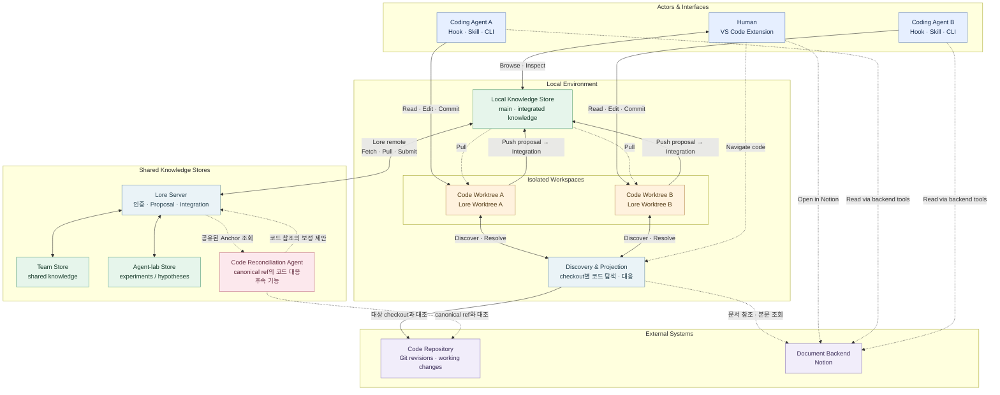
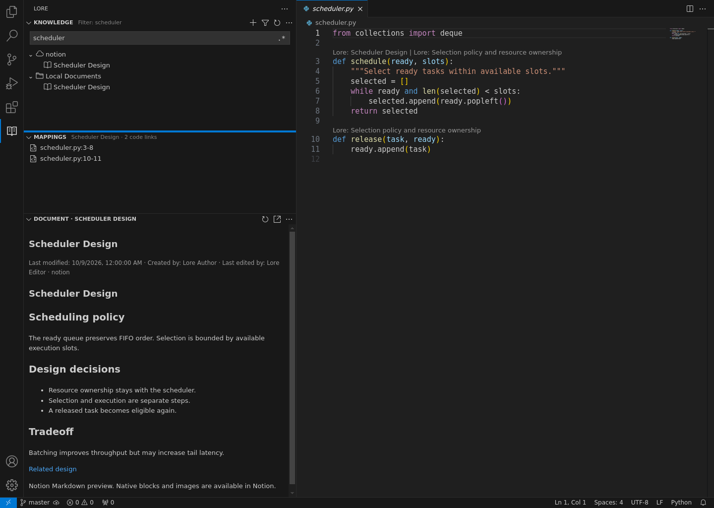
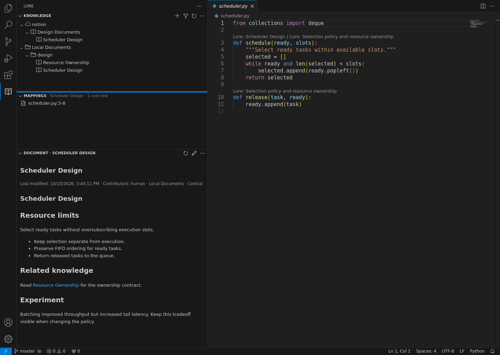
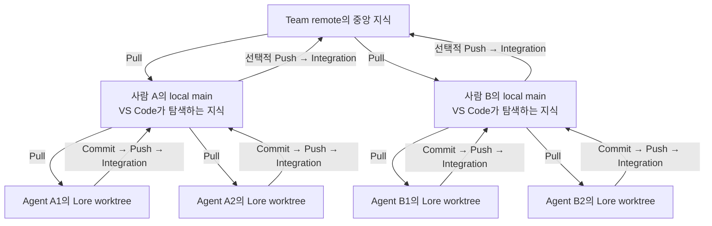

# Lore Technical Overview

Lore는 문서와 코드의 관계를 관리하고, 그 관계와 Lore-owned 문서의 변경을 로컬 또는 서버를 통해 공유합니다. 외부 문서 본문은 원래 백엔드에 두며, 코드 참조는 각 checkout의 코드 상태에 맞춰 해석합니다.



그림은 한 사람의 로컬 환경과 두 Agent를 예로 듭니다. Agent는 각 작업 사본에서 읽고 수정하며, 사람은 local main에 통합된 지식을 탐색합니다. Discovery와 Projection은 같은 기능을 사용해도 각 checkout의 코드 상태를 대상으로 동작하며, 하나의 공통 Projection을 공유하지 않습니다.

로컬 store는 서버 없이도 사용할 수 있습니다. 팀과 공유할 때는 Lore remote로 서버의 store를 선택하고, 외부 문서의 본문은 별도의 백엔드에서 읽습니다. 하나의 서버가 여러 store를 제공할 수 있으며, store들이 서로 다른 서버에 있어도 같은 연결 구조를 사용합니다. 그림의 Code Reconciliation Agent는 아직 후속 범위이고, 서버의 제출·통합 기능과는 별개의 구성 요소입니다.

이 문서는 Document, Mapping, Projection, Workspace를 정의한 뒤 저장·버전 관리·공유·Agent 연결의 실제 동작을 설명합니다. CLI의 `<...>`는 채울 ID나 값이며, 예시는 작업 대상 코드 checkout에서 `lore init`으로 준비한 workspace를 사용합니다. 현재 구현과 후속 기능은 각각 구분합니다.

## Document와 문서 백엔드

문서는 제목과 본문을 가진 지식이며, 코드 연결 없이도 존재할 수 있습니다. 문서 참조는 백엔드의 정체성과 그 안의 문서 ID로 구성됩니다. 제목은 읽기 위한 이름이므로 중복될 수 있고, 제목이나 위치를 바꿔도 같은 문서의 연결은 유지됩니다. 다른 백엔드로 복사한 문서는 별도의 문서이며 자동으로 같은 원본으로 간주하지 않습니다.

본문 형식, 편집, 권한, 조회 가능한 이력은 문서 백엔드의 계약을 따릅니다. Lore-owned 문서는 Lore가 관리하고, Notion 문서는 Notion이 관리합니다. 문서를 참조하거나 캐시했다고 소유권과 접근 권한이 Lore로 넘어오지는 않습니다.

### Lore-owned 문서

외부 백엔드에 작성할 필요가 없는 실험 결과나 배경 설명은 Local Documents로 남길 수 있습니다. Markdown 본문을 파일이나 표준 입력으로 작성하고, 코드 연결 없이도 저장·조회할 수 있습니다.

```bash
lore --json create "Scheduler Design" --body-file design.md --directory design
lore edit <document-id> --if-match <revision> --body-file design.md
```

편집·Archive 같은 변경은 관찰한 revision을 확인합니다. 다른 작업자가 먼저 변경했다면 내용을 조용히 덮어쓰지 않습니다. 생성·수정 결과의 revision을 다음 작업에 사용합니다.

Lore가 소유하는 문서는 Markdown을 기본 형식으로 사용합니다. 형식을 Markdown으로만 고정하지 않아 향후 **Jupyter notebook (`.ipynb`)** 같은 내용을 지원할 계획이지만, 모든 형식의 읽기·편집을 현재 지원하는 것은 아닙니다. 외부 문서는 원래 백엔드가 제공하는 본문 형식과 편집 기능을 따릅니다.

문서의 분류는 트리 구조를 사용합니다. Local Documents에는 중첩된 디렉터리가 있고, Notion 문서는 Notion의 계층을 따릅니다. 문서 디렉터리는 코드 경로나 문서의 정체성과는 별개입니다. 코드를 설명하는 위치와 사람이 문서를 정리하는 위치가 같아야 하는 것은 아닙니다.

문서끼리의 링크도 백엔드와 본문 형식의 관례를 따릅니다. 로컬 Markdown에서는 안정적인 문서 ID를 참조하는 위키 링크를 사용하고, Notion에서는 원래 페이지 링크를 활용합니다. Lore는 제공 가능한 링크를 탐색에 연결하되, 제목이 모호하면 임의의 문서로 연결하지 않습니다. 링크 대상이 아직 없거나 접근할 수 없어도 현재 문서를 읽는 일은 계속할 수 있습니다.

작성자, 변경 이력, 마지막 수정자와 수정 시각은 알 수 있는 범위에서 유지합니다. 문서 작성자와 Mapping 작성자는 별개의 정보입니다. Lore-owned 문서와 Mapping은 이력을 보존하지만, 외부 문서를 캐시했다고 Notion의 모든 과거 버전을 조회할 수 있게 되는 것은 아닙니다.

Archive도 삭제와 다릅니다. Lore-owned 문서를 archive하면 정체성, 내용, 참조를 보존하고 다시 복원할 수 있습니다. Mapping만 archive할 수도 있으며, 이때 연결된 원본 문서를 archive하지 않습니다. 현재 탐색 화면은 archived 항목을 기본적으로 숨기고 필요할 때 포함합니다. 백엔드에 접근하지 못했다는 사실을 문서 삭제로 해석하지 않습니다.

CLI의 `history`로 이전 revision을, `links`로 문서 사이의 연결을 조회합니다. `archive`와 `restore`도 관찰한 revision을 `--if-match`로 확인합니다.

위키 링크는 예를 들어 `[[id:<document-id>|Resource Ownership]]`처럼 표현합니다. 보이는 제목과 실제 문서 ID를 분리하므로 제목이나 디렉터리를 바꿔도 연결을 유지할 수 있습니다.

### Notion 발견과 읽기

Notion 연결은 페이지 ID와 코드 관계를 관리하고, 본문을 읽을 때 원래 백엔드 또는 캐시를 사용합니다. 기존 130여 개의 PR 디자인·아이디어 문서를 이관 없이 연결하고 이후 추가되는 문서에도 같은 방식을 적용할 수 있습니다. 새 코드 관계가 생겨도 Notion의 작성·편집·이력을 복제할 필요는 없습니다.

현재 VS Code 확장은 Lore 영역 안에서 문서를 읽고, 선택한 문서의 코드 연결을 별도로 보여줍니다. Notion 문서와 Local Documents는 비슷한 탐색 경험을 제공하되, 외부 문서 편집은 원래 백엔드에 맡깁니다. 목록은 트리로 탐색하고 제목을 필터링할 수 있으며, 로컬 Markdown 문서는 렌더링과 편집을 전환합니다.

Notion 본문은 Markdown preview로 읽습니다. Notion 고유 블록과 원본 편집이 필요하면 Open in Notion으로 이동합니다. 문서 상단에는 제공 가능한 마지막 수정 시각, 생성자, 마지막 수정자를 표시합니다.

읽기는 캐시를 우선 사용하고, 캐시가 없을 때 본문을 가져옵니다. 캐시된 내용은 원본보다 오래되었을 수 있습니다. 목록·문서 본문 갱신과 Lore 지식의 Pull은 뒤의 공유 절에서 설명하는 별개의 동작입니다.



*실제 VS Code 확장 화면입니다. 설명용 코드와 모의 Notion API를 사용해 촬영했습니다. Knowledge 안의 연속 제목 필터, 선택한 문서의 두 코드 연결, 아래쪽의 렌더링된 문서를 보여줍니다.*

CLI에서도 같은 문서를 탐색하고 읽을 수 있습니다.

```bash
lore init
lore docs browse notion
lore docs fetch notion
lore docs show notion <page-id>
lore docs fetch notion <page-id>
```

`docs fetch notion`은 설정된 범위의 제목 목록을 갱신하고, 문서 ID를 지정하면 그 문서를 갱신합니다. 전체 본문 캐시는 명시적인 선택입니다. VS Code의 Knowledge 새로고침도 목록 갱신이고, Document의 새로고침은 열린 문서의 갱신입니다. 제목 필터는 이미 알려진 목록에서 동작하며, 입력할 때마다 Notion을 검색하지 않습니다.

Notion 페이지는 연결하면 읽을 수 있고, 하위 문서의 목록 발견은 페이지별로 켭니다.

이 설정은 바로 아래 문서에만 적용되며 자식 페이지에 상속되지 않습니다. 읽기 권한과 목록의 발견 범위는 별개입니다. 링크를 따라 읽다가 순환하거나 깊은 계층을 만나는 일이 전체 트리의 재귀 수집으로 이어지지 않게 합니다.

문서의 링크와 코드 연결은 서로 다른 탐색 경로입니다. 관련 문서를 따라 읽는 위키 형태의 탐색과 코드 위치에서 문서를 찾는 탐색을 함께 제공합니다.

## Mapping, Anchor, Path Scope

Mapping은 안정적인 ID, 문서 참조, 한 코드 저장소의 Anchor 또는 경로 범위, 선택적인 설명을 갖는 관계입니다. 문서는 Mapping이 없어도 존재할 수 있고, 같은 문서가 여러 저장소에 연결되면 저장소별 Mapping을 둡니다. Mapping을 만들거나 수정해도 원본 문서 본문을 바꾸지는 않습니다. Lore-owned 문서에는 Anchor를 직접 붙일 수도 있습니다.

```bash
lore --json --author agent map create notion <page-id> \
  compiler/scheduler.py:100-150 --context "자원 배분 정책의 설계 배경"
lore map ls compiler/scheduler.py
```

정확한 줄을 고르기 어려운 넓은 설명은 경로 범위로 연결할 수 있습니다.

```bash
lore map create notion <page-id> --glob 'src/scheduler/**'
```

VS Code에서는 문서를 선택한 상태에서 코드 범위를 선택해 연결하고, Mappings에서 선택한 문서의 연결 수와 위치를 확인합니다. 코드의 CodeLens로 관련 문서를 열거나, 연결 목록에서 대응하는 코드로 이동할 수 있습니다.

Anchor는 파일 경로와 한 줄 또는 여러 줄의 범위뿐 아니라 **참조 당시 코드 revision과 문맥**을 보존합니다. 커밋되지 않은 코드에 연결했다면 그 사실도 구분해야 합니다. `scheduler.py:100-150`이라는 좌표만으로는 몇 달 뒤 같은 코드를 가리킨다고 판단할 수 없기 때문입니다.

같은 Mapping의 Anchor들은 한 저장소 안의 서로 다른 파일이나 코드 revision을 가리킬 수 있습니다. Path Scope는 checkout 상대 경로의 glob으로 현재 경로를 찾으며, 특정 코드 revision이나 줄의 대응을 주장하지 않습니다. 예를 들어 `src/scheduler/**`는 스케줄러 영역의 관련성을 표현하고, Anchor는 구체적인 코드 참조를 표현합니다.

Lore-owned 문서에 직접 Anchor를 붙일 때는 다음 명령을 사용합니다.

```bash
lore attach <document-id> compiler/scheduler.py:100-150
```

Mapping의 작성자·수정 이력은 문서의 작성자·수정 이력과 별개입니다. 문서 조회 실패는 Mapping 삭제나 원본 문서 삭제의 근거가 아닙니다. 현재 Mapping은 외부 문서의 관찰 revision을 기록하지 않으므로, Notion 본문 갱신만으로 연결된 설명의 신선도를 판정하지는 않습니다.

## Code Projection

Projection은 원본 Anchor를 대상 코드 상태에 대조한 결과입니다. 예를 들어 기록된 `scheduler.py`가 로컬 feature 브랜치에서 `planner.py`로 이동했다면, 원본 참조는 그대로 두고 로컬의 대응 위치를 별도로 제시합니다. 함수가 분리되면 여러 위치가 함께 대응할 수 있고, 여러 후보 중 하나를 확정하지 못할 수도 있습니다. 대응 위치를 찾지 못하는 것도 정상적인 결과입니다.

대상은 커밋된 revision이나 커밋되지 않은 변경을 포함하는 working state일 수 있습니다. 브랜치 이름은 움직이는 참조이므로 결과가 어느 코드 상태에 대한 것인지 구분합니다. 확립된 대응(Resolved), 미확정 후보(Candidate), 대응을 확립하지 못한 결과(Unresolved)를 구분하고, 여러 위치가 함께 대응하는 경우와 경쟁하는 후보도 구분합니다. resolver 실패를 대응 위치가 없다는 확정 결과로 처리하지 않습니다.

이 결과에는 다음 구분이 유지됩니다.

1. **현재 위치를 찾았다고 원래 참조가 바뀐 것은 아닙니다.** 다른 worktree는 다른 코드 상태에 대한 projection을 가질 수 있습니다.
2. **현재 위치를 찾았다고 문서 내용이 맞는 것은 아닙니다.** 설계가 폐기되었거나 설명의 적용 조건이 달라졌는지는 별도의 판단입니다.

### Resolver와 재사용

대응은 필요할 때 계산하고 적용 가능한 결과를 재사용할 수 있습니다. 모든 코드 변경마다 모든 Anchor를 모델에 보내는 구조를 요구하지 않습니다. 현재 구현은 정확한 텍스트와 Git rename 정보를 먼저 활용하며, 설정된 모델로 미확정 후보를 제안받을 수도 있습니다. 현재 모델 모드의 기본값은 Furiosa Access의 K-EXAONE입니다. 모델 연결과 resolver profile을 통해 모델·endpoint·프롬프트를 선택합니다.

모델이 필요한 경우에만 명시적으로 요청합니다. 일반 문서 탐색과 코드 이동은 모델을 호출하지 않습니다.

```bash
lore --json map resolve <mapping-id>
```

모델이 제안한 위치는 확정된 대응과 구분합니다. 경로와 줄 범위가 유효하다는 것만으로 의미적 대응이 성립하지 않습니다. 유효한 결과를 재사용할 수 있지만, 이전 결과를 캐시했다는 사실만으로 바뀐 코드에도 적용 가능하다고 판단하지는 않습니다. 모델 후보의 영구 캐시와 확정 저장은 아직 후속 범위입니다.

서버 reconciliation은 같은 원본 참조를 공유 기준 코드에 대응시키는 역할입니다. 지식 제출·통합과의 관계 및 현재 구현 범위는 서버 절에서 설명합니다.

## Workspace와 지식 View

Workspace는 코드 checkout과 지식의 작업 브랜치·worktree를 연결합니다. `lore init`으로 준비하며, 같은 코드 저장소의 여러 worktree가 같은 로컬 Knowledge store를 사용하면 중앙 지식은 공유하고 작업 상태는 각각 갖습니다. 코드 이력과 지식 이력은 별개입니다.

| 상태 | 소유 범위 | 읽기·변경 의미 |
| --- | --- | --- |
| 기록된 미커밋 변경 | workspace | 작성·편집 결과입니다. 편집기의 미저장 텍스트와는 별개입니다. |
| 작업 브랜치·Lore worktree | 코드 worktree에 대응하는 지식 작업 사본 | 커밋한 지식과 기록된 변경을 읽고 수정합니다. |
| local main | 로컬 store의 해당 코드 repository 범위 | 제안이 통합된 중앙 지식입니다. 작업 브랜치의 Commit만으로 바뀌지 않습니다. |
| Projection | workspace의 대상 코드 상태 | 같은 Anchor라도 각 worktree의 코드에 별도로 대응시킵니다. |
| 불변 revision·문서 캐시 | 공유 가능 | 편집 변경이나 Projection을 공유하는 것과는 다릅니다. |

### 작업 View와 중앙 View

작업 View에는 자기 브랜치의 커밋과 workspace에 기록한 변경이 있습니다. 따라서 아직 Push하지 않은 문서도 기본 CLI의 `search`, `show`, `context discover`로 찾고 읽을 수 있습니다. `--central`은 받아들인 중앙 지식을 선택합니다. 두 View는 현재 코드 상태와도 별개입니다.

```bash
lore --json context discover compiler/scheduler.py
lore --json --central context discover compiler/scheduler.py
```

VS Code 확장은 선택한 store의 local main을 탐색 기준으로 사용합니다. local main은 중앙에 통합된 지식의 집합입니다. 통합이 사람의 검토를 의미하지는 않습니다. Agent가 자기 브랜치에서 커밋만 한 문서는 나타나지 않고, 중앙에 통합한 결과는 다른 Agent의 worktree로 전환하지 않아도 발견할 수 있습니다. 사람 자신이 편집하는 작업 사본은 따로 구분합니다. 화면에 보이는 중앙 지식과 현재 코드 checkout은 별개의 선택이므로, 그 지식의 코드 참조는 사람이 보는 코드 상태에 맞춰 해석합니다.

중앙 View를 읽는 것은 작업 브랜치를 전환하거나 중앙에 직접 커밋하는 동작이 아닙니다. 수정·Commit은 작업 상태에서 수행하고, 공유는 뒤에서 설명하는 제안·통합 흐름을 따릅니다.



*실제 확장에 설명용 로컬 지식을 통합한 화면입니다. Knowledge에는 중앙 문서가 나타나고, 선택한 문서의 연결과 본문은 Mappings와 Document에서 읽습니다. 다른 worktree의 미통합 초안은 이 목록에 섞이지 않습니다.*

이 View에서는 사람이 한 Agent의 worktree로 전환하지 않고도 여러 작업의 통합 결과를 볼 수 있고, 다른 Agent의 미완성 편집은 같은 목록에 섞이지 않습니다.

### 다른 worktree에서 만들어진 연결 읽기

Agent A가 feature 브랜치의 커밋 `A`에서 `planner.py:120–170`에 Anchor를 만들고, 그 Mapping을 커밋·Push했다고 합시다. local main에 통합되는 것은 **문서 관계와 커밋 `A`의 원본 Anchor**입니다. Agent A의 화면용 Projection을 다른 worktree의 정답으로 병합하지 않습니다.

| 읽는 환경 | 공유하는 원본 | 해당 환경의 Projection |
| --- | --- | --- |
| Agent A의 feature worktree | 커밋 `A`, `planner.py:120–170` | 같은 코드의 대응 위치 |
| 사람의 오래된 master checkout | 동일한 원본 Anchor | 예를 들어 `scheduler.py:100–150` |
| Agent B의 다른 브랜치 | 동일한 원본 Anchor | 그 브랜치의 대응 위치, 여러 후보 또는 미해결 |

B는 Pull로 지식 변경을 반영하거나 중앙 지식을 직접 발견할 수 있고, 코드를 연결해서 읽을 때 자신의 코드 상태에 대응시킵니다. **지식 통합과 Code Projection은 독립적**입니다. 중앙에 받아들였다고 모든 checkout의 코드 위치를 확정한 것도 아니고, B의 Projection이 없다고 Mapping 통합에 실패한 것도 아닙니다. 표는 대응을 찾았을 때의 예시이며, 실제로 대응이 가능하다고 항상 보장하지 않습니다.

## 구성 요소와 연결

Lore에서 remote는 지식을 공유하는 대상에 대한 연결을 뜻합니다. 코드 저장소의 Git remote나 Notion 문서 백엔드 연결과는 별개입니다.

| 개념 | 의미 |
| --- | --- |
| Code repository / Git remote | 작업 대상 코드의 저장소와 Git 연결입니다. 코드의 정체성과 이력을 제공합니다. |
| Document backend | 문서의 원본과 접근을 담당합니다. Notion 같은 외부 서비스나 Lore가 소유하는 문서가 해당합니다. 백엔드의 종류와 연결된 문서 공간의 정체성은 구분됩니다. |
| Knowledge store | Lore-owned 문서, 매핑, 작업 이력, 통합된 중앙 지식, 변경 제안을 관리하는 지식 저장소입니다. |
| Lore remote | Lore server를 통해 특정 Knowledge store에 접근하는 이름 있는 연결입니다. `team` 같은 로컬 이름은 연결 대상의 고유 ID와 다릅니다. |
| Lore server | 인증과 권한을 확인하고 공유 지식의 조회, 제출, 통합을 제공합니다. 하나의 서버가 여러 독립된 store를 제공할 수 있습니다. |
| Workspace | 코드 checkout과 지식 작업 상태를 연결하는 로컬 작업 환경입니다. 어떤 store를 사용하고, 어떤 변경과 projection을 보유하는지 관리합니다. |
| Lore worktree / working branch | 한 workspace의 지식 작업 사본과 이력입니다. 코드 worktree와 대응하지만, 코드 저장소 안에 문서를 넣지는 않습니다. |
| Mapping / Anchor | 문서와 코드의 지속적인 관계, 그리고 그 관계가 가리키는 구체적인 코드 참조입니다. |
| Projection / Resolver | 기록된 코드 참조가 다른 코드 상태에서 어디에 대응하는지 해석한 결과와 그 해석을 수행하는 구성 요소입니다. |

Knowledge store 하나에 여러 코드 저장소와 여러 문서 백엔드를 등록할 수 있습니다. store 안에서는 코드 저장소별로 중앙 지식과 작업 이력을 관리합니다. 반대로 같은 코드 저장소에 대해 서로 다른 팀이 독립된 store를 운영할 수도 있습니다. 같은 Notion 문서 공간을 참조하더라도 서로 다른 코드 관계를 축적할 수 있습니다.

따라서 “이 코드 저장소를 열었다”만으로 어느 팀의 지식을 쓰는지가 정해지지는 않습니다. workspace가 로컬 store를 선택하고, 공유할 때는 Lore remote를 선택합니다. 저장소·백엔드 등록은 공유 공간의 구성이고, 개인의 토큰과 연결 이름은 그 공간을 사용하는 환경의 설정입니다. 접근 권한도 저장소와 백엔드의 조합을 유지합니다.

로컬에서 혼자 사용하거나 여러 worktree 사이에서 공유할 때는 서버를 띄울 필요가 없습니다. 코드 저장소 밖의 로컬 store가 중앙 역할을 합니다. 현재 기본 위치는 `~/.local/share/lore/`이며, 다른 store를 선택할 수도 있습니다. Lore remote를 같은 머신의 서버로 구성하는 것도 가능하지만 필수는 아닙니다.

연결 관계를 수로 표현하면 서버는 여러 store를 제공할 수 있고, store와 코드 저장소·문서 백엔드는 각각 N:M 관계입니다. 하나의 문서는 여러 코드 저장소에 연결될 수 있지만, 개별 Mapping은 한 문서와 한 코드 저장소를 연결합니다. 그 안에서 여러 Anchor나 경로 범위를 사용할 수 있습니다. 여러 로컬 remote 이름이 같은 store를 가리킬 수도 있습니다.

첫머리의 그림처럼, Workspace는 선택한 작업·중앙 View와 알려진 원격 관계에서 관련 문서를 조회하고, 본문을 읽을 때 문서 캐시나 원래 백엔드를 사용합니다. 서버는 팀의 공유 상태를 관리하며, 외부 문서에 대한 개인 인증을 대신 부여하는 역할은 아닙니다. Resolver는 필요할 때 호출하며 모든 읽기나 동기화에 개입하지 않습니다.

### 연결 설정과 실행 환경

로컬 store 연결은 작업할 지식 공간을, Lore remote는 공유할 서버와 store를, backend 연결은 문서 접근과 발견 범위를 선택합니다. 모델 연결은 API와 인증을, resolver profile은 모델과 프롬프트를 선택합니다. 하나를 바꾼다고 나머지 연결을 다시 만들 필요는 없습니다. 인증은 개인 실행 환경에 두고 지식 이력에는 넣지 않습니다.

CLI, VS Code, Hook은 공통 작업 의미를 사용합니다. 문서 백엔드, 이력 저장소, 서버, resolver, 기록 정책은 각자의 책임에 따라 교체할 수 있도록 경계를 둡니다. 다만 경계를 분리했다는 것이 모든 저장 엔진과 백엔드를 이미 구현했다는 뜻은 아닙니다.

설치·서버·모델 연결의 구체적인 명령은 [README](../README.md), Agent 설정은 [Codex 연결 안내](../integrations/codex/README.md)를 참고합니다.

### 독립적인 구성 요소와 단계적 활용

로컬 Knowledge Store에 기존 Notion 문서와 코드의 관계를 기록하면, 개발자는 VS Code에서 코드를 탐색하며 관련 설계 문서를 함께 읽고 연결을 관리할 수 있습니다.

Agent Hook을 연결하면 Coding Agent도 같은 지식을 발견하고 활용합니다. Agent가 새 문서나 코드 관계를 기록·통합하면 이후 작업에서도 재사용할 수 있습니다.

복수 worktree에서는 각자의 지식 작업을 격리하고 local main에 통합합니다. Lore remote는 이 공유 범위를 팀이나 별도의 지식 공간으로 확장합니다. 향후 Reconciliation Agent를 연결하면 공유된 코드 참조의 유지·보정을 자동화할 수 있습니다.

각 기능은 공통의 Document, Mapping, Workspace 모델을 사용하며, 작업 환경에 따라 개별적으로 활용하거나 조합할 수 있습니다.

## 버전 관리와 지식 공유

현재 Git이 Lore의 커밋·브랜치·worktree 이력을 저장합니다. 코드 저장소와 별개의 이력이며 GitHub 게시나 Git 전송 프로토콜을 요구하지 않습니다. 버전 관리되는 지식 상태에는 Lore-owned 문서와 Mapping이 들어가고, 외부 문서 본문·캐시·자격 증명·Projection은 들어가지 않습니다.

기록된 버전은 불변이고 수정과 통합은 새 버전을 만듭니다. Lore-owned 문서의 본문·메타데이터·Anchor와 외부 문서 Mapping의 상태는 이력에 남지만, Notion의 편집 이력은 계속 Notion이 관리합니다.

Lore Push는 상위 중앙에 Proposal을 생성하고, Integration이 이를 중앙에 받아들입니다. `git push`처럼 remote branch ref를 갱신하는 규약이 아니라 PR 생성과 Merge에 대응하는 의미입니다.

### Git 기반 이력과 동작 구분

| 단계 | Lore에서의 의미 |
| --- | --- |
| 작성·편집 | workspace에 변경을 기록합니다. 다른 브랜치나 중앙에 게시하지 않습니다. |
| Commit | 선택한 문서 또는 Mapping의 기록된 상태를 작업 브랜치 이력에 담습니다. |
| Push | 상위 중앙에 변경 제안을 생성합니다. 원격 브랜치 ref를 갱신하는 `git push`와 다릅니다. |
| Integration | 제안을 중앙에 통합합니다. PR Merge에 대응하는 단계입니다. |
| Fetch | 공유 지식을 관찰·캐시하며 작업 상태와 통합 기준은 바꾸지 않습니다. |
| Pull | 받아들인 중앙 변경을 자신의 지식 상태에 통합합니다. |
| Checkout / Worktree | 지식 작업 브랜치와 작업 사본을 선택·조회합니다. 코드 checkout을 변경하지 않습니다. |

Git은 커밋·브랜치·worktree와 이력 저장을 맡습니다. Lore는 무엇이 문서 변경인지, 어떤 공유 기준에 제안하는지, 무엇을 충돌로 보고 언제 받아들이는지를 정의합니다. Git 자체가 문서의 의미나 설명의 정확성을 판정하는 것은 아닙니다. 서버 인터페이스에서는 버전 토큰을 특정 Git 해시 형식으로 가정하지 않으며, 저장소 구현과 HTTP 공유 프로토콜도 분리합니다. [Git worktree](https://git-scm.com/docs/git-worktree), [Git remote](https://git-scm.com/book/en/v2/Git-Basics-Working-with-Remotes)

일반적인 Git Index와 같은 **별도 Lore staging 단계는 현재 없습니다.** 작성·편집은 workspace에 기록된 미커밋 변경이고, `commit <id>`가 문서 하나 또는 Mapping 하나를 선택합니다. 다른 객체의 기록된 변경은 미커밋 상태로 남습니다. 편집기의 아직 저장하지 않은 텍스트도 별개입니다. 선택한 객체는 본문·메타데이터·Anchor를 포함한 기록된 상태로 커밋하므로 필드나 hunk를 부분 staging하는 동작은 아닙니다.

```bash
lore init
lore --json --author agent create "Scheduler experiment" --body-file experiment.md
lore commit <document-id> --if-match <revision>
lore push
lore --central show <document-id>
```

로컬 Push는 **작업 브랜치에 커밋된 변경을 함께 제안**합니다. `commit <id>`로 방금 선택한 객체만 제출한다는 뜻은 아니므로, 같은 브랜치의 이전 미제출 커밋도 확인해야 합니다. 기록 skill도 다른 작업의 커밋을 함께 게시하지 않도록 확인합니다. 아래의 팀 Push는 객체를 선택해 별도 제안을 구성한다는 점에서 제출 범위가 다릅니다.

로컬의 기본 Push는 제안을 만든 뒤 충돌이 없으면 즉시 통합합니다. 이는 로컬 공유를 간편하게 하는 정책이며, **통합이 사람의 검토를 의미하지는 않습니다.** `push --proposal`로 제안만 남기고, `proposal show`로 비교한 뒤 명시적으로 Integration할 수도 있습니다.

작업 상태는 `lore worktree`로 확인하고, `lore checkout investigation --create`로 별도의 지식 브랜치를 만들 수 있습니다. 미커밋 변경이 있으면 전환을 거부해 보존합니다. 다른 작업 브랜치는 `lore pull`로 중앙 변경을 반영하며, 충돌을 조용히 덮어쓰지 않습니다.

### 팀에 선택적으로 제출하기

```bash
lore pull --remote team
lore push --remote team --document <document-id>
lore push --remote team --mapping-id <mapping-id>
```

원격 Push는 로컬 브랜치 전체를 전송하는 동작이 아닙니다. **마지막 성공한 원격 Pull의 기준 상태를 바탕으로, 선택한 객체를 local main의 현재 상태로 반영한 Proposal을 구성합니다.** 선택하지 않은 객체는 그 기준 상태를 유지하므로 로컬의 다른 문서·Mapping 변경이 함께 제출되지 않습니다. 미커밋 변경이나 외부 문서 본문도 포함하지 않습니다. `--all`은 명시적으로 모든 로컬 중앙 지식을 선택하는 동작입니다.

Mapping이 Lore-owned 문서를 참조한다면 대상 Store에서 가져온 기준 상태에 그 문서가 있거나 함께 제출해야 합니다. 빠진 문서는 자동으로 공유하지 않고 ID를 안내하며, 최종 통합 결과에서도 참조 무결성을 확인합니다. Archive된 문서는 존재와 참조를 유지합니다. 외부 Notion 문서와 본문의 일반 링크에는 같은 존재 조건을 요구하지 않습니다.

`lore proposal --remote team show ...`와 `integrate ...`로 원격 제안을 확인·통합합니다. `lore pull --remote team`은 팀 결과를 local main에 반영하고, 작업 브랜치는 다시 `lore pull`로 반영합니다. 이때 서버 reconciliation은 코드 참조를 보정하는 선택적 역할이며, Proposal 생성이나 지식 통합 그 자체가 아닙니다.

### Integration과 충돌 처리

Proposal의 기준과 제출 내용은 고정됩니다. 로컬 Push의 기준은 작업 브랜치와 중앙의 Git 공통 조상이고, 원격 Push는 마지막 성공한 Pull의 기준을 사용합니다. Integration은 현재 중앙 버전을 조건으로 객체별 3-way 비교를 수행합니다. 서로 다른 객체의 변경이나 동일한 변경은 통합할 수 있지만, 같은 문서나 Mapping의 서로 다른 변경은 충돌로 남깁니다. 문서 안의 서로 다른 문장을 수정했다고 자동으로 합치지는 않습니다.

Proposal은 전체를 통합하거나 중앙을 그대로 둡니다. 이미 통합된 Proposal을 다시 제출·통합하면 당시 결과를 반환하고, 충돌한 Proposal은 원래 기준과 내용을 유지한 채 새 중앙 상태에 대해 다시 시도할 수 있습니다. 조회는 확정된 한 commit의 snapshot을 읽으며, 제출된 Proposal도 Git ref로 보존해 GC 대상이 되지 않게 합니다.

제안, 기준 상태, 중앙 상태를 비교해 해결안을 만들고, 적용할 때 관찰한 상태가 여전히 같은지 확인합니다. 재시도해도 같은 제출을 중복 게시하지 않으며, 작업 중 발생한 로컬 편집을 잃지 않아야 합니다. **Push 성공, 중앙 통합, 작업 브랜치 반영은 서로 다른 결과**입니다.

적용과 통합은 관찰한 버전을 조건으로 수행합니다. 기준 상태는 성공적으로 반영한 뒤에만 전진하고, 충돌이 남으면 제안·기준·중앙 상태를 보존합니다. Pull이 중앙 통합 후 기준 저장 전에 중단되면, 다음 실행에서 기존 통합을 확인하고 기준 저장을 마친 뒤 새로운 원격 상태를 반영합니다. 사용자나 Agent가 해결안을 준비할 수 있지만, 관련 상태가 바뀌었다면 다시 확인해야 합니다.

### Fetch, Pull, 캐시

Fetch한 상태와 Pull로 통합한 상태는 구분됩니다.

| 동작 | 바꾸는 상태 | 바꾸지 않는 상태 |
| --- | --- | --- |
| 원격 Fetch | 관찰·캐시 | local main, 작업 브랜치, 반영 기준 |
| 원격 Pull | local main과 해당 원격의 반영 기준 | 각 작업 브랜치 |
| 작업 브랜치 Pull | 자기 브랜치에 반영한 중앙 변경 | 미완성 편집은 보존하고 충돌을 구분 |
| 백엔드 문서 Fetch | 목록 또는 지정한 문서 본문 캐시 | Lore 브랜치·통합 기준 |

문서 백엔드의 목록·본문 Fetch는 이 지식 통합과 독립적입니다. 캐시는 공유할 수 있지만 미완성 편집과 현재 코드의 Projection은 worktree별 상태입니다. 실패한 갱신은 이전 캐시를 버리는 이유가 되지 않습니다.

Git이 버전 관리·작업 격리·통합의 모델이라면, DVC는 데이터 가용성과 작업 상태를 구분하는 참고 모델입니다. DVC도 [Fetch](https://doc.dvc.org/command-reference/fetch)와 [Pull](https://doc.dvc.org/command-reference/pull)을 구분하지만, Lore의 제안·의미적 통합까지 같은 규약을 쓰는 것은 아닙니다. 현재 Lore-owned 원격 Fetch에는 본문이 포함되며, 모든 원격 지식을 코드 파일별로 잘라 전송하는 기능은 아직 지원하지 않습니다.

### 로컬 중앙과 팀 중앙



각 working branch는 자기 커밋을 로컬 중앙에 제안하고, 개인의 local main은 팀 중앙에 선택한 객체를 제안합니다. 개인 중앙은 자기 Agent들에게는 공유 대상이고 팀에는 제출자입니다. 같은 Proposal/Integration 모델을 두 관계에 적용하지만, 로컬 Push의 제출 범위와 즉시 통합 정책은 원격 Push와 다릅니다. 저장·Commit·제안·통합을 분리하므로 작업 이력과 공유 시점도 구분됩니다.

## 다중 Store와 Store 간 제출

하나의 로컬 store는 여러 Lore remote에 연결할 수 있습니다. 원격 Pull 기준은 출발 로컬 Store, 코드 repository, 대상 연결별로 유지합니다. 같은 로컬 Store를 쓰는 worktree들은 그 기준을 공유하지만 독립 Store는 공유하지 않습니다. Push 대상은 명시적으로 선택하고, 같은 코드 저장소와 백엔드를 등록했더라도 각 Store의 중앙 상태와 이력은 독립적입니다.

예를 들어 `agent-lab`과 `team`을 연결해 Agent의 조사·가설과 팀 지식을 따로 운영할 수 있습니다. 여러 remote 연결은 어느 공간을 조회·제출할지 선택하는 기능이며, store 간의 자유로운 이전이나 승격 추적을 의미하지 않습니다.

현재 가능한 공유는 로컬 중앙을 거칩니다. `agent-lab`의 지식을 Fetch하면 캐시에만 있고, Pull로 local main에 받아들인 뒤에야 그 객체를 `team`에 선택적으로 Push할 수 있습니다. 각 remote에 대한 Pull 기준과 접근 권한이 필요하며, 코드 저장소와 참조하는 백엔드의 정체성도 대상 공간에서 일치해야 합니다.

| 질문 | 현재 구현의 의미 |
| --- | --- |
| 다른 store에서도 같은 문서인가? | 제출한 Lore-owned Document ID와 Mapping ID, 문서·관계의 상태를 유지합니다. 외부 문서는 같은 backend/document 참조를 유지합니다. |
| 이력도 그대로 옮기는가? | 전체 원본 이력은 전송하지 않습니다. 대상 store의 기준에 맞춰 부모 revision을 다시 기록하고, 대상에서 제안·통합 이력을 만듭니다. store별 revision 토큰은 서로 대체할 수 없습니다. |
| 승격한 문서를 원래 공간에서 수정하면? | 자동 전파되지 않습니다. 변경을 로컬 중앙에 받아들여 다시 제안해야 합니다. 대상에서도 같은 객체가 수정됐다면 기준 상태와 비교해 충돌을 구분합니다. |

이 경로는 선택한 객체의 상태를 다른 공간에 제안합니다. 반복 제출은 대상에서 Pull한 객체 상태를 기준으로 비교하며, 같은 ID나 다른 Store의 revision 토큰으로 공통 조상을 추론하지 않습니다. ID를 유지한다고 원본과 승격본의 관계를 추적하는 것도 아닙니다. 전체 이력 이전, remote 간 직접 전송, 서로 다른 backend 정체성의 재연결은 제공하지 않습니다. 독립적으로 만든 객체를 같은 지식으로 판정하거나 지속적으로 양방향 동기화하는 규칙도 아직 정하지 않았습니다.

사람에게 노출하기 전에 선별하려면 remote 이름뿐 아니라 사용하는 로컬 store와 발견 범위도 구분해야 합니다. 실험 공간과 팀 공간을 같은 local main에 Pull하면 그 내용은 한 화면에 나타날 수 있습니다. Agent 전용 store는 이런 경계를 활용하는 운영 방식이며, 자동 품질 등급이나 승격 UI를 제공한다는 뜻은 아닙니다.

### 출처, 통합, 검토는 다른 사실입니다

| 사실 | 알 수 있는 것 | 추론할 수 없는 것 |
| --- | --- | --- |
| 작성·수정 출처 | 사람 또는 Agent가 기여했다는 기록 | 사람이 내용을 검토했거나 설명이 옳다는 보장 |
| 중앙 통합 | 해당 공간의 공유 상태에 받아들여짐 | 검토 완료 또는 높은 품질 |
| 사람의 검토 | 명시적으로 확인한 내용과 범위 | 다른 revision이나 바뀐 코드에도 같은 판단이 적용됨 |

사람이 작성하거나 수정했다는 사실을 검토 기록으로 대신하지 않습니다. 검토 상태를 표현할 때도 출처나 통합 상태와 독립적으로 다뤄야 합니다. **현재 별도의 초안·미검증·검토 완료 상태 모델과 검토 필터는 구현하지 않았습니다.** 화면의 Central 표시나 human 출처를 Reviewed로 읽어서는 안 됩니다.

로컬 기본 Push와 현재 기록 skill은 비충돌 지식을 자동 통합할 수 있습니다. 사람이 보기 전에 선별하려는 환경에서는 proposal-only 제출이나 별도 실험 store를 사용하는 정책이 필요합니다. 별도 공간은 선별할 경계를 제공하지만, 분리나 통합 자체가 지식의 품질을 보증하지 않습니다.

## 서버와 Code Reconciliation

서버 하나는 여러 store를 제공하고, 사용자별 repository/backend 조합의 읽기·쓰기 권한을 확인합니다. Lore-owned 본문을 공유할 권한과 Notion Mapping을 볼 권한은 구분되며, Mapping 접근이 Notion 본문 접근을 부여하지 않습니다.

Lore server는 공유 공간의 서비스입니다. 저장소를 선택하고, 요청자를 인증하고, 변경 제안을 받아 통합하는 역할은 모델의 지능에 의존하지 않습니다. Store의 기본 `conflict_free` 정책은 충돌 없는 변경을 통합하고, `fast_forward_only` 정책은 새 Proposal의 기준과 현재 중앙 버전이 같을 때만 통합합니다. 두 정책 모두 중앙 Agent 없이 동작하며, 이미 통합된 제안의 재시도에는 기존 결과를 반환합니다.

Push는 지식 변경 제안을 저장하고, Integration은 그 제안을 공유 이력에 받아들입니다. **Reconciliation은 제출된 코드 참조를 canonical ref에 대응시키는 별도의 역할**입니다. 예를 들어 `upstream/master`에 대응하는 위치를 기록할 수 있지만, 모든 사용자의 코드 checkout을 그 ref에 맞추거나 문서 본문을 다시 쓰지 않습니다. 결과는 원본 Anchor의 정체성과 실제 대상 코드 revision을 유지하고, 대응하지 못하면 원본과 미해결 상태를 보존합니다. 서버의 상시 reconciliation worker는 아직 후속 범위입니다.

별도의 Agent나 worker는 이 코드 대응을 보정하거나 오래된 관계를 조사하는 역할을 맡을 수 있습니다. 하지만 이런 Agent가 없거나 일시적으로 동작하지 않는다고 Push/Pull까지 멈추게 만들지는 않습니다. 원래 참조를 보존한 채 공유하고, 대응이 해결되지 않은 상태를 구분할 수 있어야 합니다.

문서끼리의 모순, 적용 조건, 반례를 해석하는 지식 정리는 코드 참조 보정과도 별개입니다. 필요하면 Agent가 일반 문서 수정·Proposal로 제안하며, 기술적으로 통합됐다는 사실만으로 서로 다른 설명이 의미적으로 조정됐다고 보지 않습니다.

서버 자체가 내려가면 원격 제출은 할 수 없습니다. 그래도 이미 가진 문서와 관계를 읽고, 로컬 작업을 기록·커밋하고, 로컬 중앙에 제출하는 일은 계속할 수 있습니다. 모델이 필요한 새로운 Projection이나 아직 가져오지 않은 외부 문서까지 오프라인에서 제공한다고 약속하는 것은 아닙니다.

이 경계는 구조를 교체할 때도 중요합니다. 문서 백엔드, 지식 저장소, 서버, resolver 모델, Hook과 skill의 정책은 각각의 책임에 맞게 선택합니다. 서버에 쓰는 모델 토큰과 개인이 로컬에서 쓰는 토큰도 별도 설정이며, 지식 이력에 토큰이나 개인 인증을 담지 않습니다.

## Agent Discovery와 기록 정책

현재 자동 Hook은 `--central context discover --cached`로 local main과 연결된 원격의 캐시된 지식을 조회합니다. 자기 작업 브랜치의 미제출 지식까지 합쳐 자동 소개하지는 않습니다. Agent가 그 지식을 후속 작업에 활용하는 경로는 명시적 CLI 조회이며, 작업 View를 자동 Hook에도 포함하는 정책은 후속 보완 사항입니다. 사람의 통합 View와 Agent의 작업 View를 같은 것으로 가정하지 않습니다. Discovery는 문서 본문 읽기와도 구분합니다.

Agent도 사람과 같은 관계를 사용하지만, 발견을 위한 인터페이스는 다릅니다. 관련 문서를 매번 전부 읽고 어느 것이 맞는지 추측하게 하기보다, 다루는 코드 경로를 기준으로 후보 목록을 전달합니다.

예를 들어 `src/scheduler/**`에 연결된 Lore가 있다면, Agent의 문맥에 해당 경로가 등장했을 때 Hook이 문서 참조와 관련 코드 범위를 소개할 수 있습니다. 특정 명령의 `cat`, `sed`, `rg` 문법을 각각 해석해서 모든 파일 접근을 추적하는 방식에 의존하지 않습니다. 현재 adapter는 도구 입출력의 경로 언급을 이용하므로 best-effort discovery이며, 실제 파일 접근을 완벽하게 감지하는 기능은 아닙니다.

자동 소개는 본문 전체를 무조건 주입하지 않습니다. 관련 Lore가 있다는 사실, 문서 참조, 기록된 코드 범위를 먼저 전달하고, Agent가 필요한 문서를 선택해 읽게 합니다. Mapping 메타데이터는 Lore의 공유 권한을 따르며 Notion 본문 권한을 대신하지 않습니다. 라인은 참조 당시 위치일 수 있으므로 현재 코드와의 대응이 필요하면 Projection을 조회합니다. 같은 Agent 세션에서는 문서를 자동으로 최대 한 번 소개하고, 명시적 discovery와 읽기는 언제든 허용합니다.

### 기록 시점은 Hook·skill 정책이 결정합니다

Lore CLI는 작성·선택적 Commit·Push·Integration을 제공합니다. Hook은 실행 계기를, skill은 기록 여부와 제출 방식을 정합니다. CLI가 문서 생성 직후 자동으로 커밋하거나 팀에 제출하는 규칙을 내장하지는 않습니다.

| 현재 adapter의 계기 | 메커니즘과 기본 정책 |
| --- | --- |
| SessionStart | workspace를 준비하고 목록 갱신을 예약합니다. |
| PostToolUse | 경로 언급에서 관련 문서 참조를 소개하고 세션 중복을 방지합니다. 본문 작성이나 Commit은 하지 않습니다. |
| 선택적 Stop Hook | 턴 종료 시 재사용할 새 지식이 있는지 Agent에게 점검을 요청합니다. |
| 현재 기록 skill | 새 결론이 있으면 작성·수정하고, 선택한 문서를 Commit한 뒤 로컬 Push합니다. 새 지식이 없으면 기록하지 않습니다. |
| 명시적 기록 요청 | Stop을 기다리지 않고 같은 기록 skill을 사용하거나 CLI 작업을 직접 수행할 수 있습니다. |

현재 기본 정책에서는 Stop 요청 → Agent의 기록 판단 → 문서 작성 → Commit → 로컬 Push가 이어지고, 충돌이 없으면 local main에 나타납니다. 충돌이 있으면 제안을 남기며 자동으로 해결하지 않습니다. **Hook 스크립트가 문서를 생성하거나 Push하는 것은 아니며, Agent가 skill에 따라 실행합니다.** 팀 remote 제출은 별도 지시가 있어야 합니다.

기록 skill은 proposal-only 제출이나 별도 store에 기록하는 정책으로 교체할 수 있습니다. 세션 내 Hook 중복 방지는 서로 다른 Agent가 같은 결론을 기록하는 것까지 막지는 않습니다. Hook, 읽기 skill, 기록 skill, 코드 대응 resolver의 책임도 분리되어 있으므로, 특정 언어의 안내나 모델 프롬프트를 제품의 고정 규칙으로 삼지 않습니다.

Agent가 기존 Notion 도구로 본문을 읽어도 코드 관계는 Lore에 남길 수 있습니다. 새 실험 결론을 Lore-owned 문서로 남기거나, 기존 문서에 매핑만 추가하는 것도 가능합니다. 현재 Agent 연결의 중심은 구조화된 CLI 결과와 실행형 Hook·skill이고, MCP 같은 인터페이스도 같은 작업 의미를 따르는 방향입니다.

## 전체 작업 예시

1. Agent A는 자기 코드·Lore worktree에서 기존 Notion 설계 문서를 코드에 Mapping하고, 새 실험 결과를 Lore-owned 문서로 작성합니다.
2. Mapping과 문서를 Commit한 뒤 로컬 Push합니다. 충돌 없이 통합되면 local main에 나타나지만, 사람의 검토가 완료됐다는 뜻은 아닙니다.
3. 사람은 중앙 checkout의 VS Code에서 결과를 읽습니다. 다른 코드 브랜치의 Agent B도 Hook으로 관련 Lore를 발견하고, 필요한 본문을 읽습니다. 코드 위치는 B의 코드 상태에 맞춰 별도로 Projection합니다.
4. 팀에 공유할 가치가 있는 문서와 Mapping만 team remote에 제안합니다. 팀이 Integration한 결과를 다른 사람들은 Pull합니다. Notion 본문은 계속 Notion에 남습니다.

## 관련 도구와 관리 범위

관련 도구와는 문서 원본, 생성 방식, 코드 관계의 관리 범위가 다릅니다.

| 접근 | 대표적인 동작 | Lore의 대응 동작 |
| --- | --- | --- |
| Notion MCP | Notion 문서에 대한 검색·읽기·작성 도구 | 코드 경로와 줄 범위에서 관련 문서를 발견하고, 발견한 관계를 지속적으로 공유합니다. |
| Swimm의 코드 연계 Docs-as-code | 저장소의 Markdown 문서에 코드 snippet을 연결하고 함께 관리 | 원본 문서는 기존 백엔드에 유지하고, 코드와의 관계·작업 이력을 별도로 관리합니다. |
| Google Code Wiki | 코드를 분석해 구조화된 위키를 생성·갱신 | 이미 작성된 설계 의도, 논의, 실험 지식을 활용하고 코드에 연결합니다. 생성된 지식도 같은 구조로 참여할 수 있습니다. |

Swimm의 공식 FAQ에서 **코드 연계 Docs-as-code** 문서는 저장소의 Markdown 파일로 관리되고, snippet과 IDE 연결을 제공합니다. Cloud Docs도 있으므로 모든 Swimm 문서의 저장 방식에 대한 비교는 아닙니다. Lore의 Notion 연결은 문서 원본과 편집 이력을 Notion에 두고 코드 관계를 별도 이력으로 관리합니다. [Swimm 공식 FAQ](https://docs.swimm.io/faq/)

Google은 Code Wiki를 코드베이스를 분석해 변경에 맞춰 문서를 재생성하고, 코드 링크와 Gemini 기반 질의응답을 제공하는 시스템으로 소개합니다. Lore는 기존 문서 참조와 사람·Agent가 기록한 실험 지식을 코드에 연결합니다. 코드에서 다시 생성하는 위키와 기존 문서에 대한 연결 계층은 함께 활용할 수 있습니다. [Google의 Code Wiki 소개](https://developers.googleblog.com/en/introducing-code-wiki-accelerating-your-code-understanding/)

[Notion MCP](https://developers.notion.com/guides/mcp/overview)는 이미 Agent에게 Notion 검색·읽기·작성 도구를 제공합니다. Lore는 코드에서 출발하는 발견과 지속적인 코드–문서 관계를 관리합니다. Agent가 문서 제목을 떠올려 검색하기 전에, 지금 다루는 파일에 관련 문서가 있다는 사실을 알려줄 수 있습니다. Notion MCP로 본문을 읽거나 편집하면서 Lore로 매핑을 관리하는 사용 방식도 가능합니다.

## 현재 범위와 후속 기능

현재 구현에서는 Notion 연결과 캐시된 문서 탐색, Local Documents, 코드 매핑과 로컬 Projection, VS Code·CLI·Agent Hook, 독립된 Lore worktree, 로컬 중앙 통합과 HTTP 기반 원격 제안·통합을 사용할 수 있습니다. 일반 탐색과 동기화는 모델 없이 가능하고, 모델 기반 Projection은 선택적으로 사용합니다.

**Jupyter notebook (`.ipynb`) 본문과 추가 문서 형식 지원**, 서버의 상시 reconciliation worker, 더 세밀한 원격 부분 조회, 더 풍부한 위키 탐색과 추가 문서 백엔드는 발전시킬 영역입니다. 출처와 별개인 검토 기록, 작업 지식의 자동 소개, store 간 승격 관계와 이력 이전도 구체화할 영역입니다. 이 항목들을 현재 제공하는 기능으로 가정하지 않습니다.

핵심 행동 계약은 [Architecture](architecture/overview.md), [Knowledge Model](architecture/knowledge-model.md), [Workspace](architecture/workspace.md), [Synchronization](architecture/synchronization.md), [Code Projection](architecture/code-projection.md)에 남깁니다. 사용자 경험의 의도는 [Experience](experience.md)를 참고할 수 있습니다.

기존 매핑 전용 동기화 명령은 호환성을 위해 남아 있습니다. 새 지식 공유는 이 문서의 commit → proposal → integration 흐름을 기준으로 사용합니다. 실제 모델의 대응 품질과 운영 환경의 부하·배포 검증은 기능 계약이나 모의 API 테스트만으로 확인할 수 없으므로 별도의 검증이 필요합니다.
